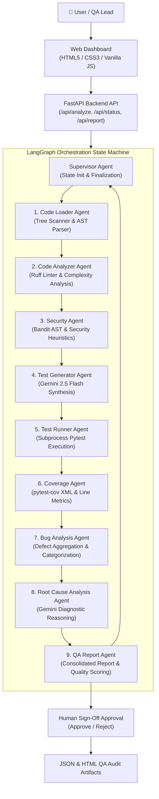

# AI QA ENGINEER 🤖🔬
### Multi-Agent AI-Powered Automated Code Quality & Testing Platform

[](https://www.python.org/downloads/)
[](https://fastapi.tiangolo.com)
[](https://langchain-ai.github.io/langgraph/)
[](https://ai.google.dev/)

---

## 1. Project Overview

**AI QA Engineer** is an autonomous multi-agent software testing and quality assurance platform designed to replicate the end-to-end cognitive workflow of a human Senior QA Automation Engineer. 

By orchestrating specialized AI agents via **LangGraph** and combining deterministic verification tools (**Ruff, Bandit, Pytest, Pytest-cov**) with generative reasoning (**Google Gemini 2.5 Flash**), the platform loads target Python repositories, inspects syntax and code smells, performs AST-level security audits, synthesizes unit test cases, executes test suites, calculates code coverage, performs root-cause analysis (RCA), and generates an executive QA audit report.

---

## 2. Problem Statement

Modern software delivery demands continuous testing and rapid release cycles. However:
1. **Manual QA Bottlenecks**: Writing comprehensive edge-case unit tests and tracing test failures back to their root cause is time-consuming and labor-intensive.
2. **Shallow Test Suites**: Developers often test only the "happy path," leaving critical zero-division, boundary, and type errors undetected.
3. **Security Blindspots**: Vulnerabilities like SQL injections, command injections, and hardcoded secrets routinely slip into production codebases.
4. **Scattered Tooling**: Static linters, security scanners, test runners, and coverage tools generate siloed outputs without contextual synthesis or actionable fix advice.

---

## 3. System Objectives

- **Automate Full-Lifecycle QA**: Zero-configuration code loading, linting, security analysis, test generation, test execution, coverage calculation, and reporting.
- **Multi-Agent Specialization**: Distribute cognitive tasks across 10 specialized agent roles orchestrated by a Supervisor state machine.
- **Prevent LLM Hallucination**: Use deterministic tools for empirical measurements (pass/fail, coverage %, lint rules) and reserve the LLM strictly for reasoning, explanation, and synthesis.
- **Root Cause & Fix Generation**: Provide actionable technical explanations, business impact evaluations, and code-level fixes for detected defects.
- **Human-in-the-Loop Governance**: Provide an interactive sign-off workflow where QA leads can approve or reject the final analysis.

---

## 4. Multi-Agent Architecture



---

## 5. Agent Catalog & Responsibilities

| # | Agent Name | Primary Responsibility | Primary Tool / Engine |
|---|---|---|---|
| 1 | **Supervisor Agent** | Manages job lifecycle, transitions state, coordinates error handling | LangGraph StateGraph |
| 2 | **Code Loader Agent** | Discovers Python files, parses metadata, extracts source buffers | Pathlib / OS / AST |
| 3 | **Code Analyzer Agent** | Checks PEP 8 compliance, code smells, and cyclomatic complexity | Ruff & AST Visitor |
| 4 | **Security Agent** | Detects SQL injection, command execution, and hardcoded secrets | Bandit (AST) & Heuristics |
| 5 | **Test Generator Agent** | Synthesizes pytest unit tests covering edge cases & failure modes | Gemini 2.5 Flash |
| 6 | **Test Runner Agent** | Executes generated test suite, captures stdout/stderr & failures | Pytest Subprocess Engine |
| 7 | **Coverage Agent** | Measures line-by-line test coverage across all modules | pytest-cov (XML/Stdout) |
| 8 | **Bug Analysis Agent** | Correlates failed tests, linter issues, and security flags into bugs | Gemini LLM + Rule Engine |
| 9 | **Root Cause Agent** | Explains *WHY* defects occurred, business impact, and code fixes | Gemini 2.5 Flash (RCA Prompt) |
| 10 | **QA Report Agent** | Calculates quality & risk scores, writes executive summary | Multi-Metric Scoring Engine |

---

## 6. Technology Stack

- **Backend**: Python 3.11+, FastAPI, Uvicorn, Pydantic v2
- **AI & Orchestration**: Google Gemini 2.5 Flash (`google-genai` SDK), LangGraph, LangChain Core
- **Testing & Measurement**: Pytest, Pytest-cov, Pytest-json-report
- **Static Analysis & Security**: Ruff, Bandit, Python AST
- **Frontend**: HTML5, CSS3 (Custom Dark Glassmorphic Theme), Vanilla JavaScript (Zero build step required)
- **Logging**: Loguru

---

## 7. Quick Installation & Setup

### Prerequisites
- Python 3.11 or higher installed on your system.

### Option A: 1-Click Launch (Windows)
Double-click `run.bat` in the root folder. It will automatically create the virtual environment, install dependencies, and launch the server.

### Option B: Manual Terminal Launch
```bash
# 1. Clone repository & navigate to directory
cd ai_qa_engine

# 2. Create virtual environment
python -m venv venv

# 3. Activate virtual environment
# On Windows:
venv\Scripts\activate
# On Linux/macOS:
# source venv/bin/activate

# 4. Install dependencies
pip install -r requirements.txt

# 5. (Optional) Configure Gemini API Key
cp .env.example .env
# Edit .env and set: GEMINI_API_KEY=your_key_here
# Note: If no API key is supplied, DEMO_MODE runs automatically with full fidelity.

# 6. Run FastAPI Server
python backend/main.py
```

Open your browser and navigate to: **`http://localhost:8000`**

---

## 8. Built-in Demo Project (`demo_project/`)

The repository includes a ready-to-run sample project in `demo_project/` containing intentionally planted, realistic defects:
1. `calculator.py`: Zero-division omission in `divide()`, missing upper-bound check in `calculate_discount()`, empty list crash in `average()`.
2. `user_service.py`: Hardcoded `SECRET_KEY` and `API_KEY`, plaintext password storage, MD5 usage.
3. `payment.py`: Shell injection vulnerability (`subprocess.run(..., shell=True)`), unvalidated payment amounts, plaintext credit card logging.
4. `database.py`: Direct string interpolation SQL injections in `get_user()` and `create_user()`.
5. `utils.py`: Arbitrary code execution via `pickle.load()` and `eval()`.
6. `test_calculator.py`: Baseline test suite demonstrating missing boundary tests.

---

## 9. 5–7 Minute Presentation & Viva Demo Script

### **Step 1: Introduction & Problem (0:00 - 1:00)**
> *"Good morning respected guide and coordinator. Today, I am demonstrating **AI QA ENGINEER**, a multi-agent automated testing and code quality platform. Traditional QA involves manual test authoring, running disparate linting tools, and manually debugging failed tests. Our system acts as an autonomous AI QA team that automatically discovers bugs, runs tests, and explains root causes."*

### **Step 2: Architecture & Multi-Agent Concept (1:00 - 2:00)**
> *"Rather than relying on a single monolithic LLM prompt—which often hallucinates numbers—our architecture uses **LangGraph** to coordinate 10 specialized agents. Notice our core design principle: empirical measurements like test pass/fail and code coverage use deterministic tools like Pytest and Bandit, while LLMs are reserved for cognitive tasks like test synthesis and root-cause analysis."*

### **Step 3: Live Execution (2:00 - 3:30)**
> *(Click **"Load Built-in Demo Project"**, then click **"START AI QA ANALYSIS"**)*
> *"Watch the live LangGraph pipeline on screen. You can see the state machine transition in real-time: Code Loader parses the AST, Code Analyzer runs Ruff, Security Agent executes Bandit AST checks, Test Generator uses Gemini to write Pytest tests, Test Runner executes them in a subprocess, and Coverage Agent measures line coverage."*

### **Step 4: KPI Dashboard & Detected Defects (3:30 - 4:30)**
> *(Scroll to the Results Dashboard)*
> *"Within seconds, the QA Report Agent synthesizes an Overall Quality Score of 72/100 and a Security Score of 68/100. It detected 6 defects, including 1 Critical, 2 Major, and 3 Minor issues."*

### **Step 5: Inspecting Root Cause Analysis (4:30 - 5:30)**
> *(Click on **BUG-001** in the Bug Table)*
> *"When we click on a bug, our Root Cause Analysis Agent explains WHY the defect happened, the exact affected function, the business and technical impact, and provides a verified code-level fix with a 96% AI confidence score."*

### **Step 6: Security, Tests & Human-in-the-Loop Sign-off (5:30 - 6:30)**
> *(Click through Security, Generated Tests tabs, then open Executive Summary tab)*
> *"Under the Security tab, Bandit pinpointed SQL injection and shell execution flaws. Under the Executive Report, the Senior QA narrative summarizes the release readiness. Finally, we demonstrate **Human-in-the-Loop Governance** where the QA Lead can review the findings and officially approve or reject the release."*

---

## 10. API Documentation

| Method | Endpoint | Description |
|---|---|---|
| `GET` | `/` | Serves the interactive web dashboard |
| `GET` | `/health` | Returns server health and demo mode state |
| `GET` | `/api/demo` | Lists built-in demo files |
| `POST` | `/api/analyze` | Initiates LangGraph analysis job for a directory path |
| `POST` | `/api/upload` | Accepts a `.zip` archive, unpacks, and initiates analysis |
| `GET` | `/api/status/{job_id}` | Polls real-time workflow status & progress percentage |
| `GET` | `/api/report/{job_id}` | Retrieves full JSON QA audit report |
| `POST` | `/api/approve/{job_id}` | Human sign-off endpoint (`approved` / `rejected`) |

---

## 11. Future Scope
1. **Multi-Language Support**: Expand AST visitors to support Java, TypeScript/JavaScript, and Go.
2. **CI/CD GitHub Action**: Package the multi-agent pipeline as a GitHub Action to gate Pull Requests automatically.
3. **Auto-Patching Agent**: Add an automated Pull Request creation agent to apply suggested RCA fixes directly to the codebase.
